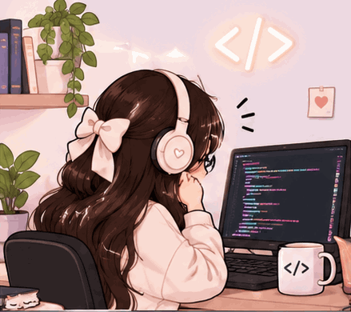

<h1 align="center">Hi 👋, I'm Rifah Tasnia</h1>

<h3 align="center">
  CSE Student | Aspiring Software Engineer
</h3>

  🌸 Welcome to my GitHub profile 🌸

<!-- GIRL CODING ANIMATION -->

  

---

### 👩‍💻 About Me

- 🎓 CSE Student at Southeast University
- 💻 Learning C, C++ and Java
- 🔐 Interested in Cyber Security
- 🌱 Exploring Software Development
- ✨ Always learning new things

---

### 🛠️ Languages & Tools

  

---

### 📌 My Goals

- Improve my programming skills
- Build real-world projects
- Learn Software Testing
- Explore Cyber Security
- Become a skilled Software Engineer

---

---

### 🌷 Thank You for Visiting!

  Keep Learning, Keep Growing! 💗

  

